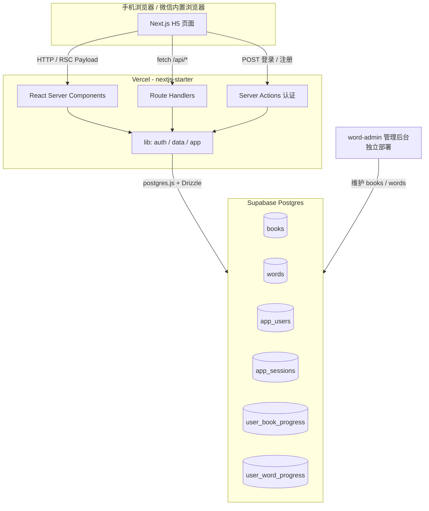
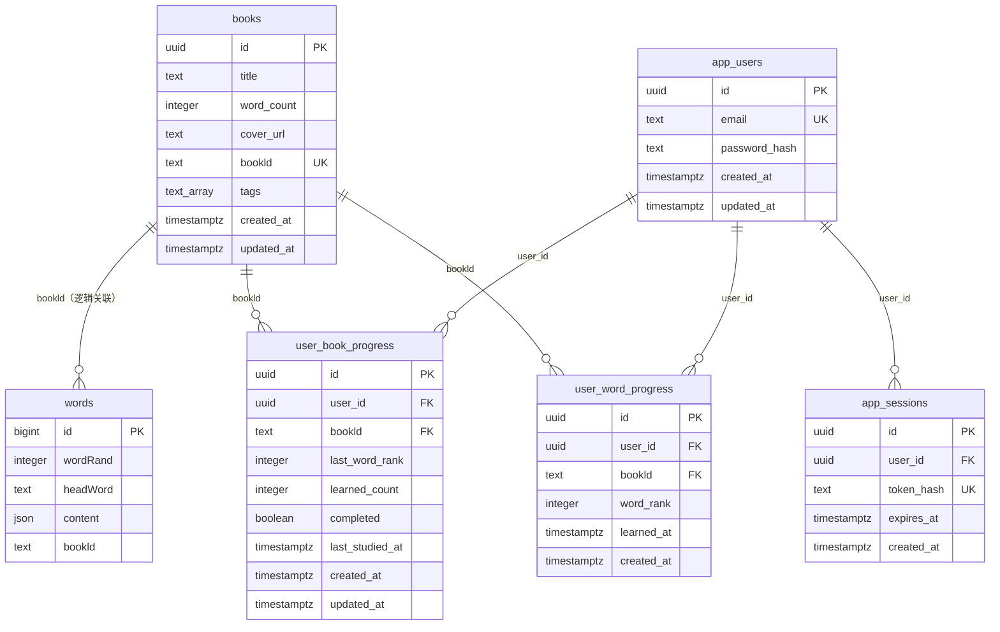
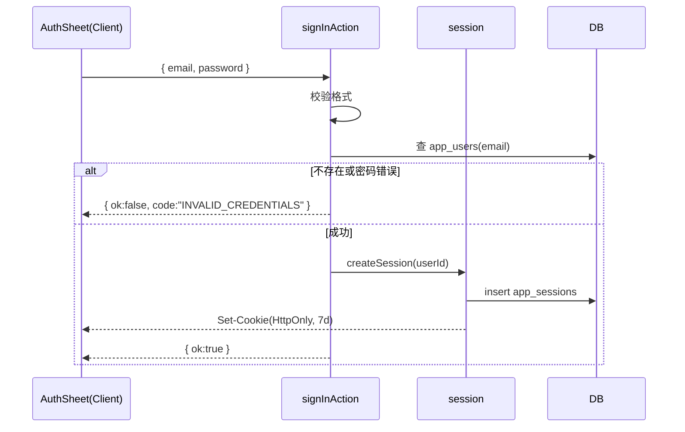
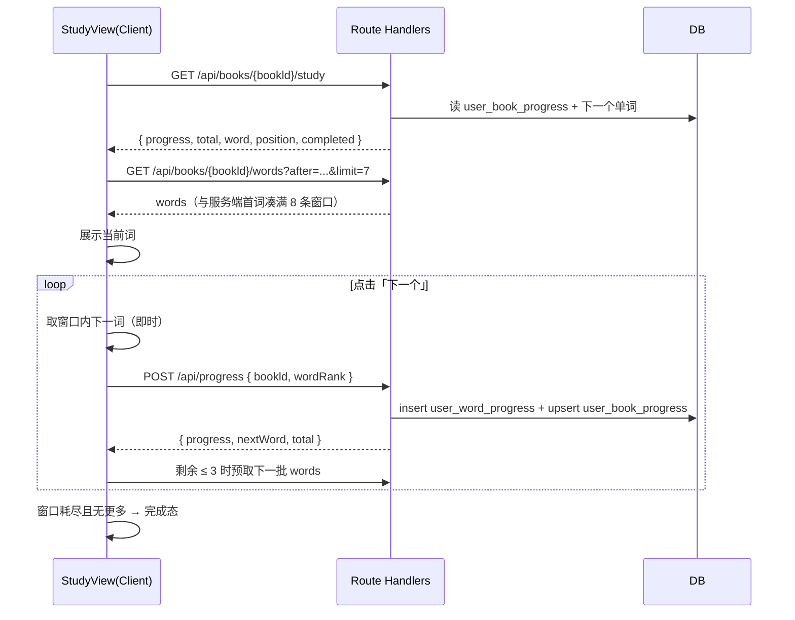

# WordsLearn H5 — 技术设计文档（design.md）

| 项目 | 内容 |
| --- | --- |
| 文档版本 | v1.0 |
| 日期 | 2026-11-15 |
| 关联文档 | `docs/proposal.md` |
| 应用目录 | `wordslearn/nextjs-starter` |
| 数据来源 | Supabase Postgres（`books`、`words` 已有；本期新增用户与进度表） |
| 参考实现 | `word-admin`（Drizzle + Supabase、scrypt 密码、HttpOnly 会话；认证沿用 Server Actions，学习与进度改为 Route Handlers） |

---

## 1. 概述

### 1.1 建设内容

在 `nextjs-starter` 中新建一个独立部署的 H5 应用：

- 首页：单词书列表；登录用户额外展示「最近学习」
- 我的：用户信息、学习进度、退出登录
- 登录 / 注册弹窗（邮箱 + 密码）
- 单词学习页：极简卡片 + 下一个
- 单词详情页：音标、释义、例句、短语、同近义词、同根词

与 `word-admin` **共用同一个 Supabase 数据库**，但用户体系、会话 Cookie、部署完全隔离。

### 1.2 关键设计决策

| 决策 | 结论 | 理由 |
| --- | --- | --- |
| 渲染模式 | App Router + RSC 为主，交互岛屿用 Client Component | 首屏快、鉴权在服务端 |
| ORM / 驱动 | Drizzle ORM + postgres.js | 与 `word-admin` 保持一致，复用连接配置 |
| 用户表 | 新建 `app_users` / `app_sessions` | 与管理员 `admin_users` 隔离，避免越权 |
| 会话 | 随机 Token + Cookie，DB 存 Token 哈希，7 天 | 防重放；与管理员会话互不影响 |
| 学习进度 | 双表：`user_book_progress`（`(user_id, bookld)` 唯一）+ `user_word_progress`（`(user_id, bookld, word_rank)` 唯一） | 断点续学与最近学习走书级表，逐词去重统计走词级表 |
| 单词切换 | 客户端预取单词窗口（8 条），点击即时切换，后台异步写进度 | 满足 < 200ms 的切换体验 |
| 数据访问方式 | 学习/进度用 Route Handlers + `lib/data/*.ts`；认证保留 Server Actions | 进度可异步、可重试，接口边界清晰 |
| 单词书关联 | 通过 `bookld` 逻辑关联 `books` ↔ `words` / `user_book_progress` / `user_word_progress` | 沿用现有数据模型 |
| 登录入口 | URL `?auth=1` 控制弹窗，服务端感知登录态 | 刷新/深链可恢复，避免闪烁 |

---

## 2. 技术栈与版本

与 `word-admin` 对齐，避免同仓库两套版本：

| 分类 | 选型 | 版本 |
| --- | --- | --- |
| 框架 | Next.js（App Router） | 16.4.6 |
| UI 库 | React / React DOM | 19.3.0 |
| 语言 | TypeScript | 5.x（strict） |
| 样式 | Tailwind CSS + `@tailwindcss/turbopack` | 4.3.3 |
| 组件 | shadcn/ui（按需拷贝到 `components/ui`）+ lucide-react | — |
| ORM | drizzle-orm | 0.45.4 |
| 驱动 | postgres（postgres.js） | 4.1.1 |
| 迁移 | drizzle-kit | 0.31.11 |
| 数据库 | Supabase Postgres（Supavisor 连接池） | — |
| 部署 | Vercel（Root Directory = `nextjs-starter`） | — |

> 注意：Supabase 连接池（Supavisor）不支持 prepared statements，`postgres()` 必须设置 `prepare: false`。

---

## 3. 系统架构

### 3.1 总体架构



### 3.2 职责划分

| 层 | 职责 | 位置 |
| --- | --- | --- |
| 页面层 | 路由、布局、首屏数据拼装 | `app/**/page.tsx`、`layout.tsx` |
| 交互层 | 弹窗、卡片切换、表单状态 | `components/**`（`"use client"`） |
| 动作层 | 登录 / 注册 / 退出（Server Actions） | `app/actions/auth.ts`（`"use server"`） |
| 接口层 | 学习状态、批量取词、单词详情、进度读写（Route Handlers） | `app/api/**/route.ts` |
| 领域层 | 查询封装、内容解析、校验 | `lib/data/*.ts`、`lib/auth/*.ts`、`lib/word-content.ts`、`db/*.ts` |
| 数据层 | 表结构、连接、迁移 | `db/schema.ts`、`db/index.ts`、`drizzle/` |

### 3.3 与 word-admin 的隔离

| 项 | word-admin | nextjs-starter |
| --- | --- | --- |
| 用户表 | `admin_users` | `app_users` |
| 会话表 | `admin_sessions` | `app_sessions` |
| Cookie | `word_admin_session` | `wordslearn_session` |
| 登录失败提示 | 管理员语境 | 用户语境 |
| 部署 | 独立项目 | 独立项目 |

数据库 `books`、`words` 由管理后台写入，H5 只读；`user_book_progress`、`user_word_progress` 只由 H5 写入。

---

## 4. 工程结构

```
nextjs-starter/
├── app/
│   ├── layout.tsx                      # 根布局：ToastProvider + AppProvider、字体、viewport
│   ├── globals.css                     # Tailwind 4 + 主题变量
│   ├── error.tsx                       # 全局错误边界（重试）
│   ├── not-found.tsx                   # 404 页面
│   ├── (tabs)/
│   │   ├── layout.tsx                  # 底部 Tab 布局（内容区 + TabBar）
│   │   ├── loading.tsx                 # 首页骨架屏
│   │   ├── page.tsx                    # 首页（Client，读取 AppProvider）
│   │   └── profile/page.tsx            # 我的（Client，登录弹窗 / 进度列表）
│   ├── study/
│   │   └── [bookld]/
│   │       ├── page.tsx                # 学习页（渲染 StudyView）
│   │       └── word/[wordRank]/page.tsx# 单词详情
│   ├── actions/
│   │   └── auth.ts                     # signUpAction / signInAction / signOutAction
│   └── api/
│       ├── books/[bookld]/study/route.ts        # 学习状态
│       ├── books/[bookld]/words/route.ts        # 预取单词窗口
│       ├── books/[bookld]/words/[wordRank]/route.ts  # 单词详情
│       └── progress/route.ts           # 进度列表 / 保存 / 重置
├── components/
│   ├── layout/tab-bar.tsx              # 底部双 Tab（Client）
│   ├── auth/auth-sheet.tsx             # 登录/注册底部弹窗（Client）
│   ├── books/book-card.tsx             # 单词书卡片
│   ├── books/recent-card.tsx           # 最近学习卡片
│   ├── study/study-view.tsx            # 学习会话（Client，本地窗口）
│   ├── study/word-card.tsx             # 极简单词卡片
│   ├── study/completion-view.tsx       # 完成态
│   ├── word/word-detail-view.tsx       # 详情内容
│   └── ui/*                            # shadcn 组件
├── db/
│   ├── index.ts                        # postgres.js + drizzle 实例
│   └── schema.ts                       # books / words / app_users / app_sessions / user_book_progress / user_word_progress
├── drizzle/                            # 迁移 SQL（0000_woozy_wrecker.sql、0001_shallow_kitty_pryde.sql）
├── lib/
│   ├── auth/
│   │   ├── password.ts                 # scrypt 哈希与校验
│   │   ├── session.ts                  # 创建/读取/销毁会话、getCurrentUser
│   │   ├── users.ts                    # 用户查询与创建
│   │   └── rate-limit.ts               # 进程内登录/注册限流
│   ├── data/
│   │   ├── books.ts                    # 单词书查询与词数口径统一
│   │   ├── words.ts                    # 单词查询、取词窗口、词数统计
│   │   └── progress.ts                 # 两张进度表读写
│   ├── app/
│   │   ├── store.tsx                   # AppProvider / useAppData
│   │   ├── toast.tsx                   # ToastProvider / useToast
│   │   └── types.ts                    # Book / Word / BookProgress 等类型
│   ├── word-content.ts                 # words.content 解析（卡片 / 详情）
│   └── utils.ts                        # cn 等
├── proxy.ts                            # 路由保护（Next 16 的 middleware，默认导出 proxy）
├── eslint.config.mjs
├── drizzle.config.ts
├── components.json
└── package.json
```

npm scripts（与 word-admin 一致）：

```json
{
  "scripts": {
    "dev": "next dev",
    "build": "next build",
    "start": "next start",
    "lint": "eslint",
    "db:generate": "drizzle-kit generate",
    "db:migrate": "drizzle-kit migrate",
    "db:studio": "drizzle-kit studio"
  }
}
```

> 不提供 `db:push`，避免对现有 Supabase 表产生不可控变更。

---

## 5. 数据库设计

### 5.1 现有表（只读，不改结构）

#### books

```sql
create table public.books (
  id uuid not null default gen_random_uuid(),
  title text not null,
  word_count integer not null default 0,
  cover_url text null,
  bookld text not null,
  tags text[] not null default '{}'::text[],
  created_at timestamp with time zone not null default now(),
  updated_at timestamp with time zone not null default now(),
  constraint books_pkey primary key (id),
  constraint books_bookld_unique unique (bookld)
) TABLESPACE pg_default;
```

#### words

```sql
create table public.words (
  id bigint generated by default as identity not null,
  "wordRand" integer null,
  "headWord" text null,
  content json null,
  bookld text null,
  constraint words_pkey primary key (id)
) TABLESPACE pg_default;
```

字段说明：

- `content` 保存 `{"word": {...}}` 结构，完整词典信息位于 `content.word.content`
- `wordRand` 为单词在书内的排序序号，学习顺序以此升序为准
- `word_count` 仍由管理端维护，但 H5 展示口径统一为 `words` 表实际条数（`getWordTotals()` 聚合），保证首页/我的/最近学习与学习页一致；**完成判定以实际查询结果为准**，不直接依赖该字段
- `books.bookld` 与 `words.bookld` 为逻辑关联，现有 `words` 未建外键

### 5.2 单词查询索引（已创建）

取「下一个单词」、预取窗口与详情页均按 `(bookld, wordRand)` 过滤，该索引已随迁移 `drizzle/0000_woozy_wrecker.sql` 创建：

```sql
create index if not exists words_bookld_wordrand_idx
  on public.words (bookld, "wordRand");
```

### 5.3 新增表

#### 5.3.1 app_users

```sql
create table public.app_users (
  id uuid primary key default gen_random_uuid(),
  email text not null,
  password_hash text not null,
  created_at timestamp with time zone not null default now(),
  updated_at timestamp with time zone not null default now(),
  constraint app_users_email_unique unique (email)
) TABLESPACE pg_default;
```

约定：

- 邮箱统一 `trim().toLowerCase()` 后写入，唯一约束直接作用于 `email`
- `password_hash` 格式：`scrypt:<salt_hex>:<hash_hex>`（64 字节派生密钥）
- 删除用户时联动删除会话与进度（外键 `on delete cascade`）

#### 5.3.2 app_sessions

```sql
create table public.app_sessions (
  id uuid primary key default gen_random_uuid(),
  user_id uuid not null references public.app_users (id) on delete cascade,
  token_hash text not null,
  expires_at timestamp with time zone not null,
  created_at timestamp with time zone not null default now(),
  constraint app_sessions_token_hash_unique unique (token_hash)
) TABLESPACE pg_default;

create index app_sessions_user_id_idx on public.app_sessions (user_id);
create index app_sessions_expires_at_idx on public.app_sessions (expires_at);
```

约定：

- Cookie 中放原始 Token（32 字节随机数的 hex，64 字符）
- 数据库只存 `sha256(token)`，即使库泄露也无法直接复用
- TTL 7 天，固定过期，不做滑动续期；登录成功时顺带清理过期会话

#### 5.3.3 学习进度表（user_book_progress / user_word_progress）

> `learning_progress` 为早期设计的单表方案，已废弃，不再读写。

```sql
create table public.user_book_progress (
  id uuid primary key default gen_random_uuid(),
  user_id uuid not null references public.app_users (id) on delete cascade,
  bookld text not null references public.books (bookld) on delete cascade,
  last_word_rank integer not null default 0,
  learned_count integer not null default 0,
  completed boolean not null default false,
  last_studied_at timestamp with time zone not null default now(),
  created_at timestamp with time zone not null default now(),
  updated_at timestamp with time zone not null default now()
) TABLESPACE pg_default;

create unique index user_book_progress_user_book_unique
  on public.user_book_progress (user_id, bookld);
create index user_book_progress_user_recent_idx
  on public.user_book_progress (user_id, last_studied_at);

create table public.user_word_progress (
  id uuid primary key default gen_random_uuid(),
  user_id uuid not null references public.app_users (id) on delete cascade,
  bookld text not null references public.books (bookld) on delete cascade,
  word_rank integer not null,
  learned_at timestamp with time zone not null default now(),
  created_at timestamp with time zone not null default now()
) TABLESPACE pg_default;

create unique index user_word_progress_user_book_word_unique
  on public.user_word_progress (user_id, bookld, word_rank);
create index user_word_progress_user_book_idx
  on public.user_word_progress (user_id, bookld);
```

`user_book_progress` 字段语义：

| 字段 | 语义 |
| --- | --- |
| `last_word_rank` | 最后学习过的 `wordRand`；0 表示尚未开始 |
| `learned_count` | 已学单词数；由 `user_word_progress` 去重统计后回写 |
| `completed` | 是否已学完整本书（实际查询不到更大的 `wordRand`） |
| `last_studied_at` | 最近一次学习时间，用于「最近学习」排序 |

`user_word_progress` 字段语义：

| 字段 | 语义 |
| --- | --- |
| `word_rank` | 已学单词的 `wordRand` |
| `learned_at` | 首次学习该单词的时间 |

约束与关系：

- `user_book_progress` 唯一索引 `(user_id, bookld)`；最近学习索引 `(user_id, last_studied_at)`
- `user_word_progress` 唯一索引 `(user_id, bookld, word_rank)` 保证逐词去重；普通索引 `(user_id, bookld)`
- 两张表均通过 `bookld` 外键依赖 `books.bookld` 唯一约束；管理后台删除单词书会级联清理进度
- 建表迁移：`drizzle/0001_shallow_kitty_pryde.sql`

### 5.4 ER 图



### 5.5 Drizzle Schema

```ts
// db/schema.ts
import { relations, sql } from "drizzle-orm";
import {
  bigint, boolean, index, integer, json, pgTable, text, timestamp, uniqueIndex, uuid,
} from "drizzle-orm/pg-core";

/** 现有：单词书 */
export const books = pgTable("books", {
  id: uuid("id").primaryKey().defaultRandom(),
  title: text("title").notNull(),
  wordCount: integer("word_count").notNull().default(0),
  coverUrl: text("cover_url"),
  bookld: text("bookld").notNull().unique(),
  tags: text("tags").array().notNull().default(sql`'{}'::text[]`),
  createdAt: timestamp("created_at", { withTimezone: true }).notNull().defaultNow(),
  updatedAt: timestamp("updated_at", { withTimezone: true }).notNull().defaultNow(),
});

/** 现有：单词 */
export const words = pgTable(
  "words",
  {
    id: bigint("id", { mode: "number" }).primaryKey().generatedByDefaultAsIdentity(),
    wordRand: integer("wordRand"),
    headWord: text("headWord"),
    content: json("content"),
    bookld: text("bookld"),
  },
  (table) => [index("words_bookld_wordrand_idx").on(table.bookld, table.wordRand)]
);

/** 新增：C 端用户 */
export const appUsers = pgTable("app_users", {
  id: uuid("id").primaryKey().defaultRandom(),
  email: text("email").notNull().unique(),
  passwordHash: text("password_hash").notNull(),
  createdAt: timestamp("created_at", { withTimezone: true }).notNull().defaultNow(),
  updatedAt: timestamp("updated_at", { withTimezone: true }).notNull().defaultNow(),
});

/** 新增：用户会话（只存 token 哈希） */
export const appSessions = pgTable(
  "app_sessions",
  {
    id: uuid("id").primaryKey().defaultRandom(),
    userId: uuid("user_id")
      .notNull()
      .references(() => appUsers.id, { onDelete: "cascade" }),
    tokenHash: text("token_hash").notNull().unique(),
    expiresAt: timestamp("expires_at", { withTimezone: true }).notNull(),
    createdAt: timestamp("created_at", { withTimezone: true }).notNull().defaultNow(),
  },
  (table) => [
    index("app_sessions_user_id_idx").on(table.userId),
    index("app_sessions_expires_at_idx").on(table.expiresAt),
  ]
);

/** 新增：单词书维度进度（每用户每书一条） */
export const userBookProgress = pgTable(
  "user_book_progress",
  {
    id: uuid("id").primaryKey().defaultRandom(),
    userId: uuid("user_id")
      .notNull()
      .references(() => appUsers.id, { onDelete: "cascade" }),
    bookld: text("bookld")
      .notNull()
      .references(() => books.bookld, { onDelete: "cascade" }),
    lastWordRank: integer("last_word_rank").notNull().default(0),
    learnedCount: integer("learned_count").notNull().default(0),
    completed: boolean("completed").notNull().default(false),
    lastStudiedAt: timestamp("last_studied_at", { withTimezone: true })
      .notNull()
      .defaultNow(),
    createdAt: timestamp("created_at", { withTimezone: true }).notNull().defaultNow(),
    updatedAt: timestamp("updated_at", { withTimezone: true }).notNull().defaultNow(),
  },
  (table) => [
    uniqueIndex("user_book_progress_user_book_unique").on(table.userId, table.bookld),
    index("user_book_progress_user_recent_idx").on(table.userId, table.lastStudiedAt),
  ]
);

/** 新增：单词维度进度（每用户每书每词一条） */
export const userWordProgress = pgTable(
  "user_word_progress",
  {
    id: uuid("id").primaryKey().defaultRandom(),
    userId: uuid("user_id")
      .notNull()
      .references(() => appUsers.id, { onDelete: "cascade" }),
    bookld: text("bookld")
      .notNull()
      .references(() => books.bookld, { onDelete: "cascade" }),
    wordRank: integer("word_rank").notNull(),
    learnedAt: timestamp("learned_at", { withTimezone: true })
      .notNull()
      .defaultNow(),
    createdAt: timestamp("created_at", { withTimezone: true }).notNull().defaultNow(),
  },
  (table) => [
    uniqueIndex("user_word_progress_user_book_word_unique").on(
      table.userId,
      table.bookld,
      table.wordRank
    ),
    index("user_word_progress_user_book_idx").on(table.userId, table.bookld),
  ]
);

export const booksRelations = relations(books, ({ many }) => ({
  words: many(words),
  bookProgress: many(userBookProgress),
  wordProgress: many(userWordProgress),
}));

export const wordsRelations = relations(words, ({ one }) => ({
  book: one(books, { fields: [words.bookld], references: [books.bookld] }),
}));

export const appUsersRelations = relations(appUsers, ({ many }) => ({
  sessions: many(appSessions),
  bookProgress: many(userBookProgress),
  wordProgress: many(userWordProgress),
}));

export const appSessionsRelations = relations(appSessions, ({ one }) => ({
  user: one(appUsers, { fields: [appSessions.userId], references: [appUsers.id] }),
}));

export const userBookProgressRelations = relations(userBookProgress, ({ one }) => ({
  user: one(appUsers, { fields: [userBookProgress.userId], references: [appUsers.id] }),
  book: one(books, { fields: [userBookProgress.bookld], references: [books.bookld] }),
}));

export const userWordProgressRelations = relations(userWordProgress, ({ one }) => ({
  user: one(appUsers, { fields: [userWordProgress.userId], references: [appUsers.id] }),
  book: one(books, { fields: [userWordProgress.bookld], references: [books.bookld] }),
}));
```

### 5.6 数据库连接

```ts
// db/index.ts
import { drizzle } from "drizzle-orm/postgres-js";
import postgres from "postgres";
import * as schema from "./schema";

const connectionString = process.env.DATABASE_URL;
if (!connectionString) {
  throw new Error("缺少 DATABASE_URL 环境变量");
}

const globalForDb = globalThis as unknown as {
  postgresClient?: ReturnType<typeof postgres>;
};

const client =
  globalForDb.postgresClient ??
  postgres(connectionString, {
    prepare: false,   // Supavisor 不支持预编译语句
    ssl: "require",
    max: 10,
    idle_timeout: 20,
  });

if (process.env.NODE_ENV !== "production") {
  globalForDb.postgresClient = client;
}

export const db = drizzle(client, { schema });
export { client as sql };
```

统一 `export const runtime = "nodejs"`（App Router 默认 Node），不要将数据访问放入 Edge Runtime。

### 5.7 迁移流程

1. 修改 `db/schema.ts`
2. `npm run db:generate` 生成 `drizzle/000X_*.sql`
3. 人工 Review：只允许新增表/索引；**不对 `books`、`words` 做破坏性变更**
4. 使用生产 `DATABASE_URL` 执行 `npm run db:migrate`
5. 迁移不在构建时执行（避免 Vercel 构建并发执行迁移）

---

## 6. 认证与会话设计

### 6.1 密码

复用 `word-admin/lib/password.ts`：

```ts
import { randomBytes, scrypt as scryptCallback, timingSafeEqual } from "node:crypto";
import { promisify } from "node:util";

const scrypt = promisify(scryptCallback) as (
  password: string, salt: string, keyLength: number
) => Promise<Buffer>;
const KEY_LENGTH = 64;

export async function hashPassword(password: string): Promise<string> {
  const salt = randomBytes(16).toString("hex");
  const derived = await scrypt(password, salt, KEY_LENGTH);
  return `scrypt:${salt}:${derived.toString("hex")}`;
}

export async function verifyPassword(password: string, stored: string): Promise<boolean> {
  const [scheme, salt, hash] = stored.split(":");
  if (scheme !== "scrypt" || !salt || !hash) return false;
  const expected = Buffer.from(hash, "hex");
  const derived = await scrypt(password, salt, KEY_LENGTH);
  return expected.length === derived.length && timingSafeEqual(expected, derived);
}
```

### 6.2 会话

```ts
// lib/auth/session.ts（要点）
const COOKIE_NAME = "wordslearn_session";
const TTL_SECONDS = 60 * 60 * 24 * 7; // 7 天

export async function createSession(userId: string) {
  const token = randomBytes(32).toString("hex");
  const tokenHash = hashToken(token);
  const expiresAt = new Date(Date.now() + TTL_SECONDS * 1000);

  await db.delete(appSessions).where(lt(appSessions.expiresAt, new Date()));
  await db.insert(appSessions).values({ userId, tokenHash, expiresAt });

  (await cookies()).set(COOKIE_NAME, token, {
    httpOnly: true,
    sameSite: "lax",
    secure: process.env.NODE_ENV === "production",
    path: "/",
    maxAge: TTL_SECONDS,
  });
}

export async function getCurrentUser(): Promise<SessionUser | null> {
  const token = (await cookies()).get(COOKIE_NAME)?.value;
  if (!token) return null;

  const [row] = await db
    .select({ id: appUsers.id, email: appUsers.email, createdAt: appUsers.createdAt })
    .from(appSessions)
    .innerJoin(appUsers, eq(appSessions.userId, appUsers.id))
    .where(
      and(
        eq(appSessions.tokenHash, hashToken(token)),
        gt(appSessions.expiresAt, new Date())
      )
    )
    .limit(1);

  return row ?? null; // 无会话或已过期返回 null
}

export async function destroySession() {
  const store = await cookies();
  const token = store.get(COOKIE_NAME)?.value;
  if (token) {
    await db.delete(appSessions).where(eq(appSessions.tokenHash, hashToken(token)));
  }
  store.delete(COOKIE_NAME);
}
```

设计要点：

- Token 随机、不可预测；DB 仅存 SHA-256
- Cookie：`HttpOnly` + `SameSite=Lax` + 生产 `Secure` + `Path=/`
- 登录成功重新签发 Token（防会话固定）
- 退出登录同时删 DB 会话与 Cookie
- 登录时顺带清理全表过期会话（数据量小，可接受）

### 6.3 当前用户

```ts
// lib/auth/session.ts
export async function getCurrentUser(): Promise<SessionUser | null> {
  const token = (await cookies()).get(COOKIE_NAME)?.value;
  if (!token) return null;

  // 关联 app_sessions + app_users，校验 token_hash 与 expires_at
  // 只返回 id / email / createdAt；无会话或已过期返回 null
}
```

页面与 Route Handler 均以 `getCurrentUser()` 的返回值判断登录态：Route Handler 返回 401，页面交由 `proxy.ts` 与客户端跳转 `/profile?auth=1&next=...` 引导登录。

### 6.4 路由保护

```ts
// proxy.ts
import { NextResponse } from "next/server";
import type { NextRequest } from "next/server";

const SESSION_COOKIE = "wordslearn_session";

export default function proxy(request: NextRequest) {
  const { pathname, search } = request.nextUrl;
  const hasSession = Boolean(request.cookies.get(SESSION_COOKIE)?.value);

  if (!hasSession && pathname.startsWith("/study")) {
    const url = new URL("/profile", request.url);
    url.searchParams.set("auth", "1");
    url.searchParams.set("next", pathname + search);
    return NextResponse.redirect(url);
  }
  return NextResponse.next();
}

export const config = { matcher: ["/study/:path*"] };
```

分层校验策略：

1. **proxy**：只看 Cookie 是否存在，快速拦截游客（不查库，避免边缘/额外延迟）
2. **页面 RSC / Route Handler**：`getCurrentUser()` 查库校验会话有效性
3. 会话失效时统一跳 `/profile?auth=1&next=当前地址`

### 6.5 登录 / 注册流程



注册额外步骤：

1. 校验邮箱格式、密码强度、确认密码
2. 查重 `email`
3. `hashPassword` → 插入 `app_users`
4. 直接 `createSession` 完成登录

### 6.6 校验规则

| 字段 | 规则 |
| --- | --- |
| 邮箱 | 必填，`^[^\s@]+@[^\s@]+\.[^\s@]+$`，最长 254，统一小写 |
| 登录密码 | 必填，6–64 位 |
| 注册密码 | 8–64 位，至少 1 个字母 + 1 个数字 |
| 确认密码 | 与密码完全一致 |

错误提示统一：

- 登录：`邮箱或密码错误`（不区分账号是否存在）
- 注册：`该邮箱已被注册`
- 参数：具体字段提示

### 6.7 限流（MVP）

- 以 `IP + email` 为 key，进程内滑动窗口（`lib/auth/rate-limit.ts`）：1 分钟最多 5 次登录/注册
- 超限返回错误文案「操作过于频繁，请稍后再试」
- 已知限制：Vercel Serverless 多实例下为单实例级限流，作为基础防护；后续可替换为 Upstash Redis

---

## 7. 数据访问与核心算法

### 7.1 首页数据

```ts
// lib/data/books.ts
export async function getBooks(): Promise<Book[]> {
  const [rows, totals] = await Promise.all([
    db.select().from(books).orderBy(asc(books.title)),
    getWordTotals(), // words 表实际条数
  ]);

  return rows.map((row) => ({
    ...toBook(row),
    wordCount: totals.get(row.bookld) ?? row.wordCount,
  }));
}
```

最近学习取自 `user_book_progress`，按 `last_studied_at` 倒序取第一条：

```ts
// lib/data/progress.ts
export async function getProgressList(userId: string): Promise<ProgressEntry[]> {
  const [rows, totals] = await Promise.all([
    db
      .select({ progress: userBookProgress, book: books })
      .from(userBookProgress)
      .innerJoin(books, eq(userBookProgress.bookld, books.bookld))
      .where(eq(userBookProgress.userId, userId))
      .orderBy(desc(userBookProgress.lastStudiedAt)),
    getWordTotals(),
  ]);

  return rows.map(({ progress, book }) => ({
    progress: toProgress(progress),
    book: { ...toBook(book), wordCount: totals.get(book.bookld) ?? book.wordCount },
  }));
}
```

首页数据在根布局 RSC 中读取并注入 `AppProvider`，首页/我的从 `useAppData()` 取 `books` 与 `progressList[0]`（最近学习）：

```ts
// app/layout.tsx（要点）
const user = await getCurrentUser();
const [bookList, progress] = await Promise.all([
  getBooks(),
  user ? getProgressList(user.id) : Promise.resolve([]),
]);
```

### 7.2 取「下一个单词」

规则：

- 无进度：`afterRank = 0`，取 `wordRand > 0` 的最小一条（从第一词开始）
- 有进度：取 `wordRand > last_word_rank` 的最小一条
- 没有结果 → 已到末尾

```ts
// lib/data/words.ts
export async function getNextWord(bookld: string, afterRank: number): Promise<Word | null> {
  const [row] = await db
    .select()
    .from(words)
    .where(and(eq(words.bookld, bookld), gt(words.wordRand, afterRank)))
    .orderBy(asc(words.wordRand))
    .limit(1);

  return row ? toWord(row) : null;
}
```

批量取词（学习窗口），由 `GET /api/books/[bookld]/words` 调用：

```ts
export async function getWordsAfter(bookld: string, afterRank: number, limit: number) {
  const rows = await db
    .select()
    .from(words)
    .where(and(eq(words.bookld, bookld), gt(words.wordRand, afterRank)))
    .orderBy(asc(words.wordRand))
    .limit(limit); // 上限 20 由 Route Handler 约束

  return rows.map(toWord);
}
```

### 7.3 进度写入（两张表）

`POST /api/progress` 调用 `saveWordProgress`：先向 `user_word_progress` 去重插入，再统计 `learned_count`，最后 upsert `user_book_progress`。

```ts
// lib/data/progress.ts
export async function saveWordProgress(input: {
  userId: string;
  bookld: string;
  wordRank: number;
}): Promise<SaveProgressResult> {
  const { userId, bookld, wordRank } = input;

  // 单词维度：唯一索引去重，重复学习不新增
  await db
    .insert(userWordProgress)
    .values({ userId, bookld, wordRank })
    .onConflictDoNothing();

  // 已学单词数 = user_word_progress 实际条数
  const [counted] = await db
    .select({ value: count() })
    .from(userWordProgress)
    .where(and(eq(userWordProgress.userId, userId), eq(userWordProgress.bookld, bookld)));
  const learnedCount = counted?.value ?? 0;

  // 完成判定：实际查询是否还有更大的 wordRand
  const nextWord = await getNextWord(bookld, wordRank);
  const completed = !nextWord;
  const total = await getWordCount(bookld);
  const now = new Date();

  // 单词书维度：upsert，last_word_rank 只前进
  const [row] = await db
    .insert(userBookProgress)
    .values({
      userId, bookld, lastWordRank: wordRank, learnedCount, completed,
      lastStudiedAt: now, createdAt: now, updatedAt: now,
    })
    .onConflictDoUpdate({
      target: [userBookProgress.userId, userBookProgress.bookld],
      set: {
        lastWordRank: sql`greatest(${userBookProgress.lastWordRank}, ${wordRank})`,
        learnedCount,
        completed,
        lastStudiedAt: now,
        updatedAt: now,
      },
    })
    .returning();

  return { progress: toProgress(row), nextWord, total };
}
```

> 进度写入采用「最后写入优先」。同一用户多端同时学习时可能出现进度回退到较小值，由 `greatest()` 保证不回退；`learned_count` 始终以词级表实际条数为准。

### 7.4 重置进度

`DELETE /api/progress?bookld=` 调用 `resetBookProgress`，删除该用户该单词书的两张表记录：

```ts
export async function resetBookProgress(userId: string, bookld: string) {
  await db
    .delete(userWordProgress)
    .where(and(eq(userWordProgress.userId, userId), eq(userWordProgress.bookld, bookld)));
  await db
    .delete(userBookProgress)
    .where(and(eq(userBookProgress.userId, userId), eq(userBookProgress.bookld, bookld)));
}
```

### 7.5 个人学习进度

```ts
export async function getProgressList(userId: string) {
  return db
    .select({ progress: userBookProgress, book: books })
    .from(userBookProgress)
    .innerJoin(books, eq(userBookProgress.bookld, books.bookld))
    .where(eq(userBookProgress.userId, userId))
    .orderBy(desc(userBookProgress.lastStudiedAt));
}
```

`GET /api/progress` 返回该列表，并统一用 `getWordTotals()` 覆盖 `book.wordCount`。

概览统计在应用层汇总：已学单词数、学习中单词书数（`!completed`）、已完成数。

### 7.6 单词内容解析

`content` 列为 `json`，Drizzle 返回 `unknown`，且可能是字符串，需要防御式解析：

```ts
// lib/word-content.ts
export type WordCardData = {
  headWord: string;
  phone: string | null;
  tranCn: string;
  sentence: { sContent: string; sCn?: string } | null;
};

export type WordDetailData = {
  headWord: string;
  usphone?: string;
  ukphone?: string;
  phone?: string;
  trans: { pos?: string; tranCn: string; tranOther?: string }[];
  sentences: { sContent: string; sCn?: string }[];
  phrases: { pContent: string; pCn?: string }[];
  synos: { pos?: string; tran?: string; words: string[] }[];
  relWords: { pos?: string; items: { hwd: string; tran?: string }[] }[];
};

/** content 可能是字符串或对象；兼容 { word: { content: {...} } } 与直接存 content 的情况 */
function rootContent(word: Word): Record<string, unknown> | null {
  const parsed = typeof word.content === "string" ? safeParse(word.content) : word.content;
  const root = record(parsed);
  const inner = record(record(root?.word)?.content);
  return inner ?? root;
}

export function parseWordCard(word: Word): WordCardData {
  const content = rootContent(word);
  // 取 trans[0] / sentence.sentences[0]；音标优先 usphone → ukphone → phone
}
```

`parseWordDetail(word)` 使用同一 `rootContent`，按 `trans` / `sentence.sentences` / `phrase.phrases` / `syno.synos` / `relWord.rels` 逐段映射，空数组不渲染。

渲染约定：

- 所有字段按存在性渲染，空数组不渲染模块
- 单词正文使用纯文本渲染，禁止 `dangerouslySetInnerHTML`
- 英文最多 2 行截断（卡片），详情页不截断

### 7.7 发音

- 优先：`https://dict.youdao.com/dictvoice?audio={speech}&type=1`（英）/ `type=2`（美）
- `speech` 缺失时用 `headWord`
- 加载失败降级 `window.speechSynthesis`（`en-US` / `en-GB`）
- 播放状态本地管理，离开页面时停止

---

## 8. 前端设计

### 8.1 路由与渲染策略

| 路由 | 渲染 | 数据 |
| --- | --- | --- |
| `/` | Client（`(tabs)` 布局），根 layout RSC 动态读取 Cookie | 单词书列表 + 最近学习（AppProvider 注入） |
| `/profile` | Client | 用户 + 进度列表（AppProvider 注入） |
| `/study/[bookld]` | Client `StudyView` | `/api/books/[bookld]/study` + `/api/books/[bookld]/words` |
| `/study/[bookld]/word/[wordRank]` | Client `WordDetailView` | `/api/books/[bookld]/words/[wordRank]` |

根布局通过 `connection()` 强制动态读取用户态；Route Handler 统一设置 `export const dynamic = "force-dynamic"`，避免缓存用户数据。

### 8.2 组件状态

| 组件 | 类型 | 状态 |
| --- | --- | --- |
| `TabBar` | Client | `usePathname()` 高亮 |
| `AuthSheet` | Client | 打开态来自 `searchParams.auth`，模式 login/register 本地 state |
| `StudyView` | Client | 当前词、单词窗口、进度、loading、完成态 |
| `BookCard` / `RecentCard` | Client | 无状态（数据来自 `useAppData()`） |
| `WordDetailView` | Client | 单词详情 loading / error |

不引入第三方全局状态库；用户、单词书与进度由根布局 RSC 读取后经 `AppProvider`（`lib/app/store.tsx`）注入，交互态在组件内局部管理。

### 8.3 底部 Tab

```tsx
// components/layout/tab-bar.tsx
"use client";
import Link from "next/link";
import { usePathname } from "next/navigation";
import { Home, User } from "lucide-react";

const tabs = [
  { href: "/", label: "首页", icon: Home },
  { href: "/profile", label: "我的", icon: User },
];

export function TabBar() {
  const pathname = usePathname();
  return (
    <nav className="fixed inset-x-0 bottom-0 z-40 border-t bg-background/95 backdrop-blur">
      <div
        className="mx-auto flex max-w-[480px] items-stretch"
        style={{ paddingBottom: "env(safe-area-inset-bottom)" }}
      >
        {tabs.map(({ href, label, icon: Icon }) => {
          const active = href === "/" ? pathname === "/" : pathname.startsWith(href);
          return (
            <Link
              key={href}
              href={href}
              aria-current={active ? "page" : undefined}
              className={`flex h-14 flex-1 flex-col items-center justify-center gap-1 text-xs ${
                active ? "text-primary" : "text-muted-foreground"
              }`}
            >
              <Icon className="size-5" />
              {label}
            </Link>
          );
        })}
      </div>
    </nav>
  );
}
```

内容区预留：

```css
.tab-content {
  padding-bottom: calc(56px + env(safe-area-inset-bottom) + 16px);
}
```

### 8.4 登录弹窗（AuthSheet）

- 基于 shadcn `Dialog` + 底部抽屉样式（`fixed bottom-0`，圆角上沿）
- 打开条件：`searchParams.get("auth") === "1"`
- 关闭：`router.replace(pathname)`（移除 `auth` 参数）
- 模式切换：登录 ↔ 注册，输入保留邮箱
- 提交：`useTransition` + Server Action，按钮 loading
- 成功：
  ```ts
  const next = searchParams.get("next");
  router.replace(next && safeInternalPath(next) ? next : "/");
  router.refresh(); // 刷新 RSC 登录态
  ```
- `safeInternalPath`：必须以 `/` 开头且不以 `//` 开头，防止开放重定向

### 8.5 首页

```tsx
// app/(tabs)/page.tsx（Client 伪代码）
export default function HomePage() {
  const { user, books, recent } = useAppData();

  return (
    <main className="tab-content mx-auto max-w-[480px] px-4 pt-4">
      {user && recent && <RecentCard entry={recent} />}
      <h2 className="mb-3 mt-6 text-base font-semibold">全部单词书</h2>
      {books.length === 0 ? <EmptyBooks /> : (
        <div className="grid grid-cols-2 gap-3">
          {books.map((b) => <BookCard key={b.id} book={b} loggedIn={Boolean(user)} />)}
        </div>
      )}
    </main>
  );
}
```

`BookCard` 行为：

- 已登录：`Link href={/study/${bookld}}`
- 未登录：`Link href={/profile?auth=1&next=/study/${bookld}}`

封面：

- `cover_url` 存在 → ``，`onError` 显示占位
- 不存在 → 渐变占位 + 书名首字

### 8.6 学习会话

数据流：



Route Handlers 要点：

```ts
// app/api/progress/route.ts
export async function POST(request: Request) {
  const user = await getCurrentUser();
  if (!user) return NextResponse.json({ error: "未登录" }, { status: 401 });

  const body = await request.json().catch(() => null);
  if (!body?.bookld || typeof body.wordRank !== "number") {
    return NextResponse.json({ error: "参数不完整" }, { status: 400 });
  }

  // 写入 user_word_progress（去重）+ upsert user_book_progress
  return NextResponse.json(await saveWordProgress({ userId: user.id, ...body }));
}
```

```ts
// app/api/books/[bookld]/words/route.ts（要点）
const after = Number(searchParams.get("after") ?? 0);
const limit = Math.min(Math.max(Math.trunc(limitValue), 1), 20); // 上限 20
return NextResponse.json({ words: await getWordsAfter(bookld, after, limit) });
```

客户端切换策略：

1. 初始窗口 `WINDOW_SIZE = 8`：服务端返回首个待学单词，再请求 `words?after=<rank>&limit=7` 补齐
2. 点击「下一个」立即从本地数组取下一个并渲染（无网络等待）
3. 同时异步 `POST /api/progress`；失败仅 Toast「进度保存失败，请检查网络后重试」，不阻断切换，下次点击重试
4. 窗口剩余 ≤ 3 条时调用 `GET /api/books/[bookld]/words` 预取下一批
5. 窗口耗尽且 `hasMore = false` → 展示完成态
6. 首词位置由 `/api/books/[bookld]/study` 的 `getStudyState()` 决定：
   - 有进度：`wordRand > last_word_rank` 的最小一条
   - 无进度：从 `wordRand` 最小的单词开始
   - 无结果：完成态

### 8.7 单词卡片

```tsx
<article className="rounded-2xl border bg-card p-6 shadow-sm">
  <Link href={`/study/${bookld}/word/${word.wordRand}`} className="block">
    <h1 className="text-center text-[40px] font-bold leading-tight">{word.headWord}</h1>
    {word.phone && <p className="mt-2 text-center text-sm text-muted-foreground">{word.phone}</p>}
    <p className="mt-6 text-center text-xl">{word.tranCn}</p>
    {word.sentence && (
      <div className="mt-6 border-t pt-4 text-sm text-muted-foreground">
        <p className="line-clamp-2">{word.sentence.sContent}</p>
        {word.sentence.sCn && <p className="mt-1 line-clamp-2">{word.sentence.sCn}</p>}
      </div>
    )}
  </Link>
</article>
```

进度条：`<Progress value={(learnedCount / total) * 100} />`，文案 `{learnedCount} / {total}`。

### 8.8 详情页

详情由 `WordDetailView`（Client）调用 `GET /api/books/[bookld]/words/[wordRank]` 获取，服务端用 `getWordByRank()` 查询并解析 `content`：

```ts
const response = await fetch(`/api/books/${bookld}/words/${wordRank}`, {
  cache: "no-store",
});
if (!response.ok) throw new Error("单词不存在");
const data = (await response.json()) as { word: Word };
```

分区渲染顺序：单词/音标 → 释义 → 例句 → 短语 → 同近义词 → 同根词。返回按钮使用 `router.back()`（Client 小组件），无历史时回学习页。

### 8.9 视觉规范

| 项 | 值 |
| --- | --- |
| 内容宽度 | `max-w-[480px] mx-auto` |
| 页面背景 | `#F7F7F8` / `bg-muted` |
| 卡片 | `rounded-2xl border bg-card shadow-sm` |
| 主按钮 | 宽 100%，高 48px，`rounded-xl` |
| 字号 | 标题 40 / 页面标题 18 / 正文 16 / 辅助 12–14 |
| 间距 | 8px 栅格，页面左右 16px |
| 安全区 | `env(safe-area-inset-bottom)` |

---

## 9. 接口契约（Route Handlers）

学习与进度统一使用 Route Handlers，成功时直接返回 JSON 资源对象，失败返回 `{ error }` + HTTP 状态码。

| 方法 | 路径 | 入参 | 出参 | 鉴权 |
| --- | --- | --- | --- | --- |
| GET | `/api/books/[bookld]/study` | — | `{ progress, total, word, position, completed }` | 是 |
| GET | `/api/books/[bookld]/words` | `after`（rank）、`limit`（默认 8，上限 20） | `{ words: Word[] }` | 是 |
| GET | `/api/books/[bookld]/words/[wordRank]` | — | `{ word: Word }` | 是 |
| GET | `/api/progress` | — | `{ progress: ProgressEntry[] }` | 是 |
| POST | `/api/progress` | `{ bookld, wordRank }` | `{ progress, nextWord, total }` | 是 |
| DELETE | `/api/progress?bookld=<bookld>` | `bookld` | `{ ok: true }` | 是 |

认证仍为 Server Actions（`app/actions/auth.ts`）：

| Action | 入参 | 出参 | 鉴权 |
| --- | --- | --- | --- |
| `signUpAction` | `{ email, password }` | `{ ok: true } \| { ok: false, error }` | 否 |
| `signInAction` | `{ email, password }` | `{ ok: true } \| { ok: false, error }` | 否 |
| `signOutAction` | — | `void` | 是 |

`POST /api/progress` 请求示例：

```ts
const response = await fetch("/api/progress", {
  method: "POST",
  headers: { "Content-Type": "application/json" },
  body: JSON.stringify({ bookld, wordRank }),
});

const result = (await response.json()) as {
  progress: BookProgress;
  nextWord: Word | null;
  total: number;
};
```

错误状态：

| HTTP / 场景 | 场景 | 前端处理 |
| --- | --- | --- |
| 400 | 参数不合法 / 缺少 `bookld` | 字段提示或 Toast |
| 401 | 未登录 / 会话过期 | 跳登录弹窗（携带 `next`） |
| 404 | 单词书或单词不存在 | 空状态 / 404 |
| 认证失败文案 | 邮箱或密码错误、邮箱已注册、频率超限 | 弹窗内提示 |
| 500 | 未知错误 | Toast + 重试 |

服务端校验先行：所有接口不信任前端传入的 `userId`，一律从会话读取；`POST /api/progress` 写入两张进度表并返回最新进度。

---

## 10. 安全设计

| 风险 | 措施 |
| --- | --- |
| 密码泄露 | scrypt 加盐哈希，不存明文；日志不打印密码 |
| 会话劫持 | HttpOnly + Secure + SameSite=Lax；Token 32 字节随机；DB 存哈希 |
| 会话固定 | 登录成功重新签发 Token |
| 暴力破解 | IP + 邮箱维度限流；统一错误文案 |
| 账号枚举 | 登录失败不区分账号是否存在 |
| CSRF | 写操作走同源 Route Handler + 会话 Cookie 校验，不用 GET 变更数据 |
| 开放重定向 | `next` 仅允许站内路径（`/` 开头且非 `//`） |
| XSS | 单词内容纯文本渲染，禁止 `dangerouslySetInnerHTML` |
| 越权 | 学习/进度接口从会话取 `userId`；校验 `bookld` 是否存在 |
| SQL 注入 | Drizzle 参数化查询，禁止字符串拼接 SQL |
| 环境变量泄露 | `DATABASE_URL` 仅服务端读取；不放入 `NEXT_PUBLIC_*` |

---

## 11. 性能与缓存

| 项 | 方案 |
| --- | --- |
| 首屏 | RSC 直出；首页并行查询 books 与 recent |
| 单词切换 | 本地窗口即时切换；进度异步写入 |
| 批量取词 | 每批 8 条，剩余 ≤3 预取 |
| 封面图 | `loading="lazy"` + 固定宽高比，避免 CLS |
| 单词书列表 | 数据量小；可加 5 分钟进程内缓存，管理端更新允许短暂延迟 |
| 用户态数据 | 不缓存（`cookies()` / `connection()` 动态渲染） |
| 查询索引 | `words(bookld, wordRand)`、`user_book_progress(user_id, last_studied_at)`、`user_word_progress(user_id, bookld)` |
| 打包体积 | 按需引入 lucide 图标；详情页组件不进入首页 bundle |

目标：4G 下首屏 LCP < 2.5s，单词切换感知延迟 < 200ms。

---

## 12. 异常与可观测性

- 页面级：`app/error.tsx`（重试）、`app/not-found.tsx`
- 接口级：Route Handler 捕获异常 → 返回 500 与 `{ error }`，服务端 `console.error` 记录路由、`bookld`、`userId`（不含密码/Token）
- Toast：项目自研 `lib/app/toast.tsx`（`ToastProvider` + `useToast`），`ToastProvider` 挂在根布局；成功登录/退出登录、进度保存失败等场景使用
- 关键埋点（可选）：登录成功、开始学习、完成学习、退出登录

日志禁止输出：密码、Cookie Token、完整 `DATABASE_URL`。

---

## 13. 测试策略

| 层级 | 内容 | 工具 |
| --- | --- | --- |
| 单元测试 | 邮箱/密码校验、`parseWordCard` / `parseWordDetail`、`safeInternalPath`、进度去重计数 | Vitest |
| 数据测试 | `saveWordProgress` 双表写入、完成判定、`getWordsAfter` 取词窗口 | Vitest + 测试库 |
| 组件测试 | AuthSheet 表单校验与切换、StudyView 切换与完成态 | Testing Library |
| E2E | 游客浏览 → 登录 → 学习 → 刷新恢复进度 → 退出 | Playwright |

关键 E2E 用例：

1. 游客点击单词书 → 跳 `/profile` 且弹窗自动打开
2. 登录成功 → 直达 `/study/{bookld}`
3. 学 3 个词后刷新 → 从第 4 个继续
4. 学到末尾 → 完成态 → 再学一遍从第一个开始
5. 退出登录 → 访问学习页被拦截

---

## 14. 部署与环境变量

### 14.1 环境变量

| 变量 | 必填 | 说明 |
| --- | --- | --- |
| `DATABASE_URL` | 是 | Supabase Session Pooler 连接串（IPv4 可达） |

> 不使用预编译语句；Vercel 与本地共用同一连接串。

### 14.2 Vercel

1. 新建项目，Root Directory 指向 `nextjs-starter`
2. Framework Preset：Next.js
3. 添加 `DATABASE_URL`（Production / Preview）
4. 构建命令保持默认 `next build`
5. 迁移在本地或 CI 执行，不在构建期执行

### 14.3 本地开发

```bash
cd nextjs-starter
npm install
# 配置 .env（不提交）
npm run db:migrate
npm run dev
```

---

## 15. 风险与取舍

| 风险 | 影响 | 应对 |
| --- | --- | --- |
| `words` 无外键 | 脏 `bookld` 可能导致空列表 | 查询均带 `bookld` 条件；管理端已有校验 |
| 多设备并发学习 | 进度可能被覆盖 | `greatest()` 保证不回退；最后写入优先 |
| 有道发音接口不可用 | 发音失败 | 降级 `speechSynthesis` |
| Serverless 限流不准 | 多实例下限流弱 | 后续接入 Upstash Redis |
| `content` 结构异常 | 详情页空白 | 解析器防御式处理，缺字段隐藏区块 |
| 大量单词书封面外链 | 图片加载慢/失效 | 懒加载 + 失败占位；建议管理端使用稳定图床 |

---

## 16. 附录：实施顺序

1. 初始化 `nextjs-starter`（Next 16 + TS + Tailwind 4 + shadcn）
2. 配置 Drizzle / Supabase 连接与 `db/schema.ts`
3. 生成并执行迁移（`app_users`、`app_sessions`、`user_book_progress`、`user_word_progress` 与 `words(bookld, wordRand)` 索引）
4. 实现 `lib/auth/password.ts`、`session.ts`、`users.ts`、`rate-limit.ts` 与认证 Server Actions
5. 实现 `proxy.ts` 路由保护（默认导出 `proxy`，仅检查会话 Cookie）
6. 实现 Tab 布局、首页、我的
7. 实现 AuthSheet 登录/注册弹窗
8. 实现学习页（本地窗口 + Route Handler 取词 + 异步进度写入 + 完成态）
9. 实现单词详情页与发音
10. 补齐错误态、骨架屏、Toast
11. 单元测试 + E2E，最后联调部署
