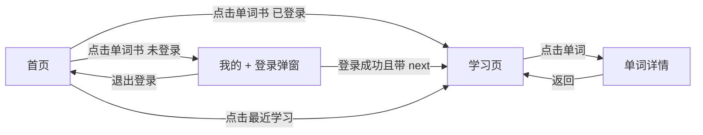
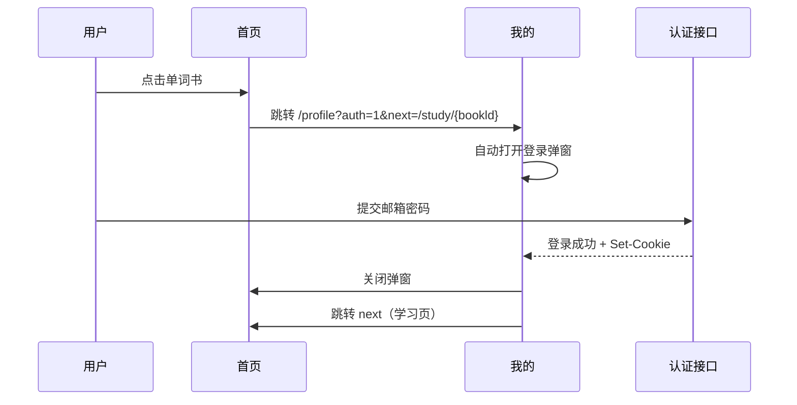
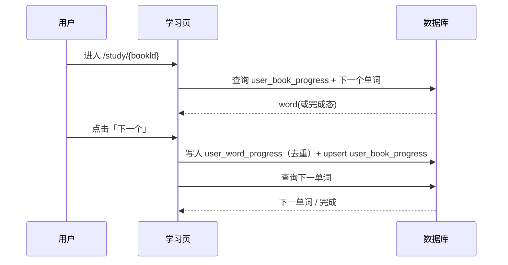

# WordsLearn H5 单词学习应用 — 需求文档（Proposal）

| 项目 | 内容 |
| --- | --- |
| 文档版本 | v1.0 |
| 日期 | 2026-11-15 |
| 状态 | 待评审 |
| 项目目录 | `wordslearn/nextjs-starter` |
| 数据来源 | Supabase（`books`、`words` 表）+ `CET4luan_2.json` |
| 参考实现 | `word-admin`（管理员认证、会话、Supabase/Drizzle 接入） |

---

## 1. 背景与目标

### 1.1 背景

现有 `word-admin` 管理后台已经具备单词书（`books`）与单词（`words`）的数据维护能力，单词数据来源于 `CET4luan_2.json`，包含音标、释义、例句、短语、同近义词、同根词等结构化字段。

现在需要一个面向 C 端用户的 **H5 单词学习应用**，让用户可以在手机浏览器中浏览单词书、登录后记录学习进度，并以卡片形式逐词学习。

### 1.2 目标

1. 用户无需登录即可浏览全部单词书。
2. 登录用户可以记录并恢复学习进度，支持「最近学习」。
3. 单词学习以极简卡片呈现，点击可查看完整单词详情。
4. 复用现有认证思路（邮箱 + 密码、哈希存储、HttpOnly 会话），复用现有 Supabase 数据结构。
5. 移动端优先，适配 375px–430px 主流手机宽度。

### 1.3 成功指标（建议）

- 首页 → 单词书详情点击率
- 登录用户次日留存
- 单次学习平均单词数
- 学习进度写入成功率 ≥ 99.9%

---

## 2. 范围与非目标

### 2.1 本期范围

- 底部双 Tab：首页、我的
- 首页：最近学习（登录且有数据时展示）、全部单词书
- 邮箱密码登录 / 注册（弹窗形式）
- 单词学习页（卡片 + 下一个）
- 单词详情页
- 学习进度记录与恢复
- 退出登录

### 2.2 非目标（本期不做）

- 社交、评论、排行榜
- 付费、会员、单词书订阅
- 搜索、分类筛选、排序
- 单词发音的真实音频资源接入（可选降级方案见 6.8）
- 离线学习、跨端同步冲突处理
- 管理后台相关功能（已由 `word-admin` 承载）

---

## 3. 用户与权限

| 角色 | 能力 |
| --- | --- |
| 游客（未登录） | 浏览首页全部单词书；点击单词书时被引导登录；不能进入学习页 |
| 登录用户 | 浏览单词书；进入学习页；记录/恢复进度；查看个人学习进度；退出登录 |

规则：

1. 游客点击单词书 → 跳转「我的」Tab 并自动弹出登录弹窗（携带目标单词书，登录成功后可直达学习页）。
2. 学习页、单词详情页仅登录用户可访问；游客访问时重定向到「我的」并打开登录弹窗。
3. 用户账号与管理员账号体系完全隔离（`app_users` / `app_sessions`，不复用 `admin_users`）。

---

## 4. 信息架构与路由

```
/                      首页（Tab 1）
/profile               我的（Tab 2）
/study/[bookld]        单词学习页（需登录）
/study/[bookld]/word/[wordRank]   单词详情页（需登录）
```

导航关系：



Tab 切换不刷新页面，保留各自滚动位置。

---

## 5. 全局规范

### 5.1 布局

- 视口宽度：`width=device-width, initial-scale=1, viewport-fit=cover`
- 内容区左右内边距：16px
- 桌面端预览：内容最大宽度 480px，居中，页面背景浅灰
- 底部 Tab 固定，高度 56px + `env(safe-area-inset-bottom)`
- 内容区底部预留 `calc(56px + env(safe-area-inset-bottom) + 16px)`，避免被 Tab 遮挡

### 5.2 视觉

- 技术栈：Next.js（App Router）+ Tailwind CSS + shadcn/ui
- 主色：沿用 shadcn 默认 primary；中性色背景 `#F7F7F8`
- 卡片圆角 16px，阴影轻量；页面字号 14–16px；单词主标题 40px
- 所有可点击元素最小热区 44×44px

### 5.3 交互

- 列表加载：骨架屏，不使用全屏 Loading
- 空状态：插画/图标 + 一句说明 + 可选操作按钮
- 错误：轻提示（Toast）+ 重试按钮
- 弹窗：底部抽屉（Bottom Sheet），遮罩点击关闭，打开时锁定背景滚动
- 所有操作按钮点击后进入 loading，防止重复提交

---

## 6. 页面需求与线框图

### 6.1 首页 — 未登录

**入口**：打开 `/`，无有效会话。

**展示内容**

1. 顶部标题「WordsLearn」+ 副标题「每天进步一点点」（可选）
2. **不展示**「最近学习」模块
3. 全部单词书列表：封面、标题、单词数量、标签（可选）
4. 底部 Tab：首页（选中）、我的

**交互**

- 点击任一单词书：
  1. 跳转 `/profile?auth=1&next=/study/{bookld}`
  2. 自动弹出登录/注册弹窗
  3. 登录成功后跳转 `next` 指向的学习页；注册成功同样处理
- 点击「我的」Tab：进入 `/profile`（未登录态）

**线框图**

```
┌─────────────────────────────────┐
│  WordsLearn                     │
│  每天进步一点点                   │
│                                 │
│  全部单词书                      │
│  ┌───────────┐  ┌───────────┐   │
│  │           │  │           │   │
│  │   封面     │  │   封面     │   │
│  │           │  │           │   │
│  ├───────────┤  ├───────────┤   │
│  │ CET4 核心 │  │ 四级高频   │   │
│  │ 3739 词   │  │ 2000 词   │   │
│  └───────────┘  └───────────┘   │
│                                 │
│  ┌───────────┐  ┌───────────┐   │
│  │    ...    │  │    ...    │   │
│  └───────────┘  └───────────┘   │
│                                 │
│                                 │
├─────────────────────────────────┤
│    ● 首页          ○ 我的        │
└─────────────────────────────────┘
```

提示文案（首次点击单词书时）：`登录后即可开始学习并保存进度`

---

### 6.2 首页 — 已登录

**展示内容**

1. 顶部标题
2. **最近学习**（存在学习记录时展示，否则整块隐藏）
   - 单词书封面、标题
   - 已学数量 / 总词数、进度条、百分比
   - 最近学习时间（如「今天 14:30」「昨天」）
   - 按钮「继续学习」
3. 全部单词书列表（同未登录，点击直接进入学习页）

**最近学习定义**

- 取当前用户 `user_book_progress` 中 `last_studied_at` 最新的一条记录
- 该记录对应单词书仍存在时展示
- 无任何学习记录时不展示该模块（不是展示空卡片）

**交互**

- 点击「继续学习」或最近学习卡片 → `/study/{bookld}`，从上次学习单词的下一个开始
- 点击其他单词书 → `/study/{bookld}`，从第一个单词开始（无进度时）

**线框图**

```
┌─────────────────────────────────┐
│  WordsLearn                     │
│                                 │
│  最近学习                        │
│  ┌───────────────────────────┐  │
│  │ [封面]  CET4 核心词汇       │  │
│  │        已学 128 / 3739     │  │
│  │        ▓▓▓░░░░░░░░  3%     │  │
│  │        最近：今天 14:30     │  │
│  │                  [继续学习] │  │
│  └───────────────────────────┘  │
│                                 │
│  全部单词书                      │
│  ┌───────────┐  ┌───────────┐   │
│  │   封面     │  │   封面     │   │
│  │ CET4 核心 │  │ 四级高频   │   │
│  │ 3739 词   │  │ 2000 词   │   │
│  └───────────┘  └───────────┘   │
│                                 │
├─────────────────────────────────┤
│    ● 首页          ○ 我的        │
└─────────────────────────────────┘
```

**空状态**

```
│  全部单词书                      │
│                                 │
│           📚                    │
│      暂无单词书，敬请期待         │
```

---

### 6.3 我的 — 已登录

**展示内容**

1. 用户信息区
   - 头像占位（邮箱首字母）
   - 邮箱
2. 学习进度
   - 概览：已学单词数、学习中单词书数、已完成单词书数
   - 单词书进度列表：封面、标题、已学 / 总数、进度条、百分比
   - 点击某项 → 对应学习页
3. 退出登录按钮（次要/危险样式）
4. 底部 Tab：我的（选中）

**交互**

- 退出登录：调用退出接口 → 清除会话 Cookie → 回到首页（未登录态）→ Toast「已退出登录」
- 退出登录需二次确认（Dialog / ActionSheet）

**线框图**

```
┌─────────────────────────────────┐
│  我的                            │
│                                 │
│  ┌────┐                         │
│  │ J  │  user@example.com       │
│  └────┘                         │
│                                 │
│  学习进度                        │
│  ┌───────────────────────────┐  │
│  │ 已学单词   学习中   已完成  │  │
│  │   256       2        0    │  │
│  └───────────────────────────┘  │
│                                 │
│  ┌───────────────────────────┐  │
│  │ [封面] CET4 核心词汇       │  │
│  │        128 / 3739   ▓▓░░  │  │
│  ├───────────────────────────┤  │
│  │ [封面] 四级高频            │  │
│  │        128 / 2000   ▓▓▓░  │  │
│  └───────────────────────────┘  │
│                                 │
│  ┌───────────────────────────┐  │
│  │        退出登录            │  │
│  └───────────────────────────┘  │
│                                 │
├─────────────────────────────────┤
│    ○ 首页          ● 我的        │
└─────────────────────────────────┘
```

---

### 6.4 我的 — 未登录

**展示内容**

1. 未登录占位：头像 + 「登录后可同步学习进度」
2. 主按钮「登录 / 注册」
3. 底部 Tab：我的（选中）

**交互**

- 点击「登录 / 注册」打开登录/注册弹窗
- 若从首页带 `auth=1` 进入，页面加载后自动打开弹窗
- 关闭弹窗后停留在「我的」页面

**线框图**

```
┌─────────────────────────────────┐
│  我的                            │
│                                 │
│           👤                    │
│      登录后可同步学习进度         │
│                                 │
│  ┌───────────────────────────┐  │
│  │       登录 / 注册          │  │
│  └───────────────────────────┘  │
│                                 │
│                                 │
├─────────────────────────────────┤
│    ○ 首页          ● 我的        │
└─────────────────────────────────┘
```

---

### 6.5 登录 / 注册弹窗

**形式**：底部抽屉，高度自适应（约 420–480px），顶部圆角 20px，带拖拽指示条。

**登录态**

| 字段 | 规则 |
| --- | --- |
| 邮箱 | 必填，邮箱格式校验，自动去除首尾空格并转小写 |
| 密码 | 必填，6–64 位 |

按钮：`登录`
底部切换：`还没有账号？立即注册`

**注册态**

| 字段 | 规则 |
| --- | --- |
| 邮箱 | 必填，格式校验，唯一性校验 |
| 密码 | 必填，8–64 位，至少包含字母与数字 |
| 确认密码 | 必填，与密码一致 |

按钮：`注册并登录`
底部切换：`已有账号？去登录`

**交互与状态**

- 提交中按钮 loading，禁用重复提交
- 失败提示：
  - 邮箱或密码错误（统一文案，不暴露账号是否存在）
  - 邮箱已被注册
  - 网络异常，请重试
- 成功后：
  1. 写入 7 天会话 Cookie
  2. 关闭弹窗
  3. 若 URL 带 `next`，跳转该地址；否则回到首页
  4. Toast「登录成功」/「注册成功」

**线框图**

```
┌─────────────────────────────────┐
│  （首页 / 我的，背景变暗）        │
│                                 │
│                                 │
├─────────────────────────────────┤
│            ━━━━                 │
│  登录                            │
│  登录后可保存学习进度             │
│                                 │
│  邮箱                            │
│  ┌───────────────────────────┐  │
│  │ name@example.com          │  │
│  └───────────────────────────┘  │
│                                 │
│  密码                            │
│  ┌───────────────────────────┐  │
│  │ ••••••••            👁     │  │
│  └───────────────────────────┘  │
│                                 │
│  ┌───────────────────────────┐  │
│  │           登录             │  │
│  └───────────────────────────┘  │
│                                 │
│      还没有账号？立即注册         │
└─────────────────────────────────┘
```

---

### 6.6 单词学习页

**路由**：`/study/[bookld]`（需登录）

**头部**

- 返回按钮（回首页）
- 单词书标题
- 进度：`128 / 3739`
- 顶部细进度条

**卡片区（极简）**

| 内容 | 字段 | 说明 |
| --- | --- | --- |
| 单词 | `headWord` | 40px 加粗，点击进入详情 |
| 美式音标 | `content.word.content.usphone` | 缺失时降级 `ukphone` |
| 中文释义 | `content.word.content.trans[0].tranCn` | 只展示第一条 |
| 例句（1 条） | `content.word.content.sentence.sentences[0]` | 只展示第一条，`sContent` + `sCn`，英文最多 2 行截断 |
| 提示 | — | 「点击单词查看详情」 |

卡片信息上限：单词、音标、1 条释义、1 条例句。短语、同近义词、同根词等完整内容仅在详情页展示。

**操作区**

- 主按钮「下一个」
- 可选（P2）「上一个」、左右滑动切换
- 点击「下一个」时：
  1. 立即从本地单词窗口（`WINDOW_SIZE = 8`）取下一个并渲染，不等待网络
  2. 异步请求 `POST /api/progress` 保存进度（`last_word_rank` = 当前 `wordRand`）
  3. 窗口剩余 ≤ 3 条时预取下一批（`GET /api/books/[bookld]/words`）
  4. 已是最后一个 → 展示学习完成态

进度保存失败仅 Toast 提示，不阻断切换，下次点击时重试。

**开始位置规则**

- 无进度：从该单词书 `wordRand` 最小的单词开始
- 有进度：取 `wordRand > last_word_rank` 的最小一条；若不存在（已到末尾），展示完成态
- 若单词书为空：展示「该单词书暂无单词」

**线框图**

```
┌─────────────────────────────────┐
│ ←   CET4 核心词汇      128/3739 │
│ ▓▓▓░░░░░░░░░░░░░░░░░░░░░░░░░░░ │
│                                 │
│  ┌───────────────────────────┐  │
│  │                           │  │
│  │         refuse            │  │
│  │        /rɪˈfjuːz/         │  │
│  │                           │  │
│  │          v. 拒绝          │  │
│  │                           │  │
│  │  She asked him to leave,  │  │
│  │  but he refused.          │  │
│  │  她叫他走，但他不肯。       │  │
│  │                           │  │
│  │     点击单词查看详情        │  │
│  └───────────────────────────┘  │
│                                 │
│                                 │
│  ┌───────────────────────────┐  │
│  │          下一个            │  │
│  └───────────────────────────┘  │
│                                 │
└─────────────────────────────────┘
```

说明：学习页采用沉浸式布局，隐藏底部 Tab，返回按钮回首页。

**加载 / 异常**

- 加载中：卡片骨架屏
- 单词书不存在：空状态 + 「返回首页」
- 进度写入失败：Toast「进度保存失败」，不阻塞切换，下次切换重试

---

### 6.7 学习完成态

当用户学到最后一个单词并点击「下一个」，或进入时已无下一个单词：

```
┌─────────────────────────────────┐
│ ←   CET4 核心词汇               │
│                                 │
│           🎉                    │
│        本单词书已学完            │
│       共 3739 个单词             │
│                                 │
│  ┌───────────────────────────┐  │
│  │        再学一遍            │  │
│  └───────────────────────────┘  │
│  ┌───────────────────────────┐  │
│  │        返回首页            │  │
│  └───────────────────────────┘  │
└─────────────────────────────────┘
```

- 「再学一遍」：删除两张进度表中该单词书的记录（相当于 `last_word_rank = 0`、`completed = false`），从第一个单词重新开始
- 重置需二次确认

---

### 6.8 单词详情页

**路由**：`/study/[bookld]/word/[wordRank]`

**内容结构**（按数据存在性渲染，空则隐藏）

1. 顶部：返回 + 所属单词书
2. 单词：`headWord`
3. 音标与发音：`usphone` / `ukphone`，点击喇叭播放
4. 释义：`trans[]`（`pos` + `tranCn`）
5. 例句：`sentence.sentences[]`（`sContent` + `sCn`）
6. 短语：`phrase.phrases[]`（`pContent` + `pCn`）
7. 同近义词：`syno.synos[]`（`pos` + `tran` + `hwds[]`）
8. 同根词：`relWord.rels[]`（`pos` + `words[]`）

**发音实现建议**

- 数据中 `speech` / `ukspeech` / `usspeech` 为有道词典音频标识
- 优先请求 `https://dict.youdao.com/dictvoice?audio={speech}&type=1|2`（1 英音 / 2 美音）
- 失败或缺失时降级为浏览器 `SpeechSynthesis`（en-US）

**线框图**

```
┌─────────────────────────────────┐
│ ←   CET4 核心词汇               │
│                                 │
│  refuse                         │
│  /rɪˈfjuːz/  🔊      /rɪˈfjuːz/ 🔊│
│                                 │
│  释义                            │
│  v. 拒绝                         │
│                                 │
│  例句                            │
│  She asked him to leave, but... │
│  她叫他走，但他不肯。             │
│                                 │
│  短语                            │
│  refuse to do   拒绝做某事       │
│  refuse treatment  垃圾处理      │
│                                 │
│  同近义词                        │
│  vt. 拒绝  negative / turn down  │
│                                 │
│  同根词                          │
│  n. refusal  拒绝；取舍权         │
│                                 │
└─────────────────────────────────┘
```

---

## 7. 核心业务流程

### 7.1 游客点击单词书



### 7.2 学习与进度更新



### 7.3 进度规则

- 进度分两张表：单词书维度 `user_book_progress`（唯一键 `(user_id, bookld)`）与单词维度 `user_word_progress`（唯一键 `(user_id, bookld, word_rank)`）
- `user_book_progress.last_word_rank` 表示**最后学习过的** `wordRand`
- 每学一个单词向 `user_word_progress` 插入一条（冲突忽略），`learned_count` 由该表去重计数得出，重复学习不累加
- 到达末尾时 `completed = true`（以实际查询不到更大的 `wordRand` 为准）
- 「再学一遍」删除两张表中该用户该单词书的记录，从第一个单词重新开始

---

## 8. 数据模型

> 复用现有 Supabase 项目的 `books`、`words` 表；新增 `app_users`、`app_sessions`、`user_book_progress`、`user_word_progress`。

### 8.1 app_users

| 列 | 类型 | 约束 | 说明 |
| --- | --- | --- | --- |
| id | uuid | PK, default gen_random_uuid() | 用户 ID |
| email | text | not null, unique | 登录邮箱（存小写） |
| password_hash | text | not null | scrypt 哈希（含 salt） |
| created_at | timestamptz | not null, default now() | 创建时间 |
| updated_at | timestamptz | not null, default now() | 更新时间 |

### 8.2 app_sessions

| 列 | 类型 | 约束 | 说明 |
| --- | --- | --- | --- |
| id | uuid | PK | 会话 ID |
| user_id | uuid | FK → app_users.id, on delete cascade | 所属用户 |
| token_hash | text | not null, unique | 会话 Token 的 HMAC 哈希 |
| expires_at | timestamptz | not null | 过期时间（签发后 7 天） |
| created_at | timestamptz | not null, default now() | 创建时间 |

### 8.3 学习进度表（user_book_progress / user_word_progress）

学习进度拆分为「单词书维度」与「单词维度」两张表，分别记录断点位置和逐词学习明细。

#### user_book_progress

```sql
create table public.user_book_progress (
  id uuid primary key default gen_random_uuid(),
  user_id uuid not null references public.app_users (id) on delete cascade,
  bookld text not null references public.books (bookld) on delete cascade,
  last_word_rank integer not null default 0,
  learned_count integer not null default 0,
  completed boolean not null default false,
  last_studied_at timestamp with time zone not null default now(),
  created_at timestamp with time zone not null default now(),
  updated_at timestamp with time zone not null default now()
) TABLESPACE pg_default;

create unique index user_book_progress_user_book_unique
  on public.user_book_progress (user_id, bookld);
create index user_book_progress_user_recent_idx
  on public.user_book_progress (user_id, last_studied_at);
```

| 列 | 类型 | 约束 | 说明 |
| --- | --- | --- | --- |
| id | uuid | PK | 主键 |
| user_id | uuid | FK → app_users.id, on delete cascade | 用户 |
| bookld | text | FK → books.bookld, on delete cascade | 关联 `books.bookld` / `words.bookld` |
| last_word_rank | integer | not null, default 0 | 最后学习的 wordRand |
| learned_count | integer | not null, default 0 | 已学单词数（由 `user_word_progress` 去重统计） |
| completed | boolean | not null, default false | 是否学完 |
| last_studied_at | timestamptz | not null, default now() | 最近学习时间 |
| created_at | timestamptz | not null, default now() | 创建时间 |
| updated_at | timestamptz | not null, default now() | 更新时间 |

唯一索引：`(user_id, bookld)`；最近学习索引：`(user_id, last_studied_at)`。

#### user_word_progress

```sql
create table public.user_word_progress (
  id uuid primary key default gen_random_uuid(),
  user_id uuid not null references public.app_users (id) on delete cascade,
  bookld text not null references public.books (bookld) on delete cascade,
  word_rank integer not null,
  learned_at timestamp with time zone not null default now(),
  created_at timestamp with time zone not null default now()
) TABLESPACE pg_default;

create unique index user_word_progress_user_book_word_unique
  on public.user_word_progress (user_id, bookld, word_rank);
create index user_word_progress_user_book_idx
  on public.user_word_progress (user_id, bookld);
```

| 列 | 类型 | 约束 | 说明 |
| --- | --- | --- | --- |
| id | uuid | PK | 主键 |
| user_id | uuid | FK → app_users.id, on delete cascade | 用户 |
| bookld | text | FK → books.bookld, on delete cascade | 所属单词书 |
| word_rank | integer | not null | 已学单词的 `wordRand` |
| learned_at | timestamptz | not null, default now() | 首次学习时间 |
| created_at | timestamptz | not null, default now() | 创建时间 |

唯一索引：`(user_id, bookld, word_rank)`；普通索引：`(user_id, bookld)`。

数据关系：

- 每个用户在每本单词书的 `user_book_progress` 中最多一条，用于断点续学与「最近学习」
- 每个用户在每本单词书的每个单词在 `user_word_progress` 中最多一条，用于去重统计 `learned_count`
- 两张表均通过 `bookld` 外键关联 `books`，单词书删除时级联清理
- 上述结构由迁移 `drizzle/0001_shallow_kitty_pryde.sql` 创建

### 8.4 复用表

- `books`：`id, title, word_count, cover_url, bookld, tags, created_at, updated_at`
- `words`：`id, wordRand, headWord, content(json), bookld`

说明：`books.word_count` 仍由管理端维护，但 H5 展示口径统一为 `words` 表实际条数（服务端 `getWordTotals()` 聚合），首页/我的/最近学习与学习页保持一致；完成判定以实际查询结果为准。

---

## 9. 接口设计（Route Handlers + 认证 Server Actions）

学习与进度读取统一走 `app/api/**/route.ts`（Route Handlers）+ `lib/data/*.ts` 服务端数据层，不再使用 Server Actions；只有认证仍使用 Server Actions（`app/actions/auth.ts`）。

| 方法 | 路径 / Action | 说明 | 鉴权 |
| --- | --- | --- | --- |
| POST | `signUpAction`（Server Action） | 注册并登录（邮箱、密码） | 否 |
| POST | `signInAction`（Server Action） | 登录（邮箱、密码） | 否 |
| POST | `signOutAction`（Server Action） | 退出登录，清除会话 | 是 |
| GET | `/api/books/[bookld]/study` | 学习页初始化，返回 `{ progress, total, word, position, completed }`；单词书不存在 404 | 是 |
| GET | `/api/books/[bookld]/words?after=<rank>&limit=<n>` | 预取 `wordRand > after` 的前 n 个单词（`limit` 上限 20），返回 `{ words }` | 是 |
| GET | `/api/books/[bookld]/words/[wordRank]` | 单词详情（服务端解析 `words.content`），不存在 404 | 是 |
| GET | `/api/progress` | 学习进度列表（含单词书信息） | 是 |
| POST | `/api/progress` | 保存进度 `{ bookld, wordRank }`，同时写两张进度表 | 是 |
| DELETE | `/api/progress?bookld=<bookld>` | 重置进度（再学一遍），删除两张表记录 | 是 |

约定：

- 首页/我的由根布局 RSC 通过 `lib/data/books.ts`、`lib/data/progress.ts` 直读，再注入客户端 Provider；学习页与进度交互调用上述 Route Handlers
- 认证方式与会话有效期（7 天）参考 `word-admin` 的 `password.ts` / `session.ts`
- Cookie：`HttpOnly`、`Secure`（生产）、`SameSite=Lax`、`Path=/`
- 所有写操作在服务端再次校验会话，不依赖前端状态；未登录统一返回 401
- Route Handler 成功时直接返回 JSON 资源对象，失败返回 `{ error }` 与对应 HTTP 状态码（400/401/404）
- 邮箱统一小写存储；密码使用 scrypt 加盐哈希

---

## 10. 字段映射（单词 JSON → UI）

数据路径：`content.word.content`（数据库 `content` 列已保存 `{"word": {...}}`）。

| UI 元素 | 字段路径 | 备注 |
| --- | --- | --- |
| 单词 | `headWord` | 顶层字段优先，缺失时取 `content.word.wordHead` |
| 美式音标 | `content.word.content.usphone` | 缺失降级英式 |
| 英式音标 | `content.word.content.ukphone` | |
| 中文释义 | `content.word.content.trans[].tranCn` | 卡片只取第 1 条 |
| 词性 | `content.word.content.trans[].pos` | |
| 英英释义 | `content.word.content.trans[].tranOther` | 详情页展示 |
| 例句 | `content.word.content.sentence.sentences[].sContent` | |
| 例句翻译 | `content.word.content.sentence.sentences[].sCn` | |
| 短语 | `content.word.content.phrase.phrases[].pContent` | |
| 短语翻译 | `content.word.content.phrase.phrases[].pCn` | |
| 同近义词 | `content.word.content.syno.synos[]` | `pos` / `tran` / `hwds[].w` |
| 同根词 | `content.word.content.relWord.rels[]` | `pos` / `words[].hwd` / `words[].tran` |
| 发音 | `content.word.content.usspeech` / `ukspeech` / `speech` | 用于音频请求 |

容错：

- `content` 可能为字符串或对象，读取前做类型判断与 `JSON.parse` 保护
- 任意字段缺失时隐藏对应模块，不渲染空标题
- 单词无释义时展示「暂无释义」，仍可切换

---

## 11. 状态与异常

| 场景 | 表现 |
| --- | --- |
| 首页加载中 | 单词书骨架卡片 |
| 首页无单词书 | 空状态「暂无单词书」 |
| 最近学习无记录 | 不渲染该模块 |
| 未登录点击单词书 | 跳「我的」+ 登录弹窗 |
| 登录失败 | 弹窗内错误文案，保留输入 |
| 会话过期 | 访问学习页时跳「我的」+ 登录弹窗，Toast「登录已过期」 |
| 单词书不存在 | 学习页空状态 + 返回首页 |
| 单词书为空 | 「该单词书暂无单词」 |
| 进度保存失败 | Toast 提示，不阻断切换 |
| 网络异常 | Toast + 重试 |
| 重复点击提交 | 按钮 loading 防抖 |

---

## 12. 非功能需求

1. **性能**：首页首屏 LCP < 2.5s（4G）；单词切换响应 < 200ms；封面图懒加载。
2. **兼容**：iOS Safari 15+、Android Chrome 100+、微信内置浏览器。
3. **安全**：密码哈希存储；会话 Token 仅存 HttpOnly Cookie；登录/注册同 IP + 邮箱每分钟最多 5 次（进程内限流）；错误文案不泄露账号是否存在。
4. **可访问性**：按钮具备 `aria-label`；文字对比度 ≥ 4.5:1；点击热区 ≥ 44px。
5. **可维护性**：认证、数据访问、UI 分层；复用 `word-admin` 的 Drizzle/Supabase 接入方式。
6. **数据一致性**：`user_book_progress` 按 `(user_id, bookld)` upsert；`user_word_progress` 按 `(user_id, bookld, word_rank)` 去重插入，`learned_count` 由该表统计。

---

## 13. 验收标准

- [ ] 未登录访问 `/`，只看到单词书，不出现「最近学习」
- [ ] 未登录点击单词书 → 跳转 `/profile` 并自动弹出登录弹窗
- [ ] 登录成功且带 `next` 时，直接进入对应学习页
- [ ] 注册成功后自动登录，会话有效期 7 天
- [ ] 已登录且存在进度时，首页展示「最近学习」及正确进度
- [ ] 无任何进度时不展示「最近学习」
- [ ] 进入学习页时从「上次学习的下一个」单词开始
- [ ] 点击「下一个」可切换单词，进度实时保存
- [ ] 学到最后一个单词后展示完成态；「再学一遍」可重置
- [ ] 点击单词可进入详情页，完整展示音标、释义、例句、短语、同近义词、同根词
- [ ] 「我的」展示邮箱、学习进度、退出登录
- [ ] 退出登录后回到未登录态，学习页不可访问
- [ ] 游客直接访问 `/study/...` 会被拦截并引导登录
- [ ] 375px 宽度下无横向滚动，底部 Tab 不被安全区遮挡

---

## 14. 后续迭代（Backlog）

- 单词发音自动播放、循环播放
- 学习计划、每日目标、打卡
- 错词本、收藏
- 搜索与分类筛选
- 学习数据统计图表
- 左右滑动切换、手势返回
- 多端进度同步冲突策略
